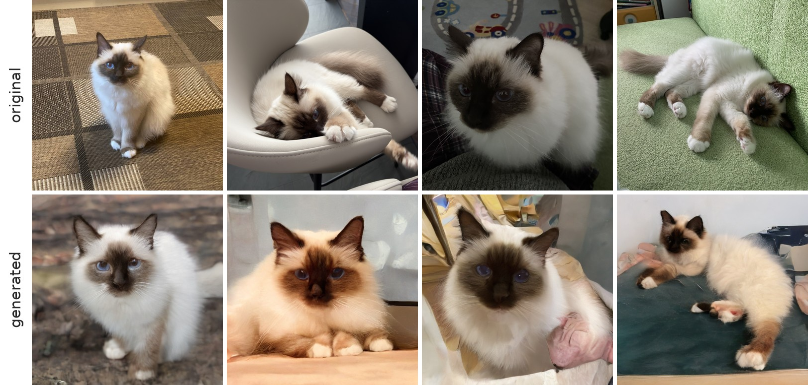
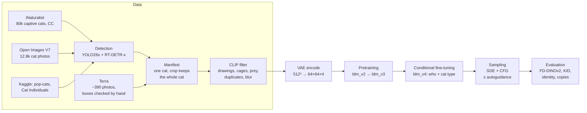

# terra-diffusion


A latent diffusion model trained from scratch on ~39k photos of cats and then taught to draw one specific cat,
**Terra**, from fewer than 300 photos. The goal: new, varied and realistic photos of Terra with correct anatomy,
not copies of the training set.



The bottom row was generated by the model. None of these images is a near copy of a training photo
(see [How we know they are not copies](#how-we-know-they-are-not-copies)), yet Terra is clearly recognisable.

## Contents

- [Results](#results)
- [Pipeline](#pipeline)
- [Model](#model)
- [Installation](#installation)
- [Usage](#usage)
- [Repository layout](#repository-layout)
- [What we learned](#what-we-learned)
- [Data and licenses](#data-and-licenses)
- [References](#references)

## Results

### Terra

512 samples per row, "Terra + her cat type", classifier-free guidance `w = 2`, SDE with 250 steps.
*Recognised as Terra* is a logistic regression on DINOv2 features trained to tell Terra from other cats
(it recognises 100% of 30 held-out photos of Terra and mistakes 0.1% of other cats for her).
*Copies* is the share of samples with a copy ratio below 0.7 (defined [below](#how-we-know-they-are-not-copies)).

| Fine-tuning step | Recognised as Terra | Copies |
|---|---:|---:|
| *30 held-out real photos of Terra* | *100%* | *3.3%* |
| 2 500 | 93.8% | 0.0% |
| 5 000 | 97.7% | 0.6% |
| **7 500** | **98.8%** | **2.5%** |
| 10 000 | 99.6% | 15.6% |
| 15 000 | 98.0% | 35.9% |
| 25 000 | 99.8% | 60.4% |

The model learns Terra quickly and then starts to memorise her photos: each of the 254 training photos was
seen about 5 000 times by step 25 000. The checkpoint at step 7 500 is the sweet spot: Terra in nearly every sample,
and fewer copies than a set of genuinely new photos of her.

### General image quality

2 000 samples per row against 10 000 real frames, SDE with 250 steps. FD-DINOv2 and KID: lower is better.
FD is biased at this sample size, so compare rows with each other, not with numbers from papers.

| Model | FD-DINOv2 | KID ×1000 (Inception) | FID (Inception) |
|---|---:|---:|---:|
| *real vs real (floor at N = 2 000)* | *72.8* | *0.04* | *13.3* |
| *VAE reconstruction (ceiling of the VAE)* | *80.7* | *0.26* | *13.6* |
| `ldm_v2`, unconditional | 1 067 | 28.5 | 49.2 |
| `ldm_v3`, unconditional | 638 | 12.8 | 30.0 |
| **`ldm_v3` + autoguidance by `ldm_v2`, w = 2** | **310** | **1.38** | **15.7** |

Inception-based metrics are close to the floor: textures look real. FD-DINOv2 is still about 4× the floor:
the remaining gap is structure, i.e. anatomy and scene layout.

## Pipeline



1. **Data.** Photos of cats from iNaturalist (captive cats with a CC licence), Open Images V7 and two Kaggle sets,
   plus personal photos of Terra.
2. **Detection.** Two detectors must agree on exactly one cat (both confident, boxes with IoU ≥ 0.7);
   the final box is their union. Open Images uses its human-annotated boxes.
3. **Manifest.** A frame is kept if a square crop can contain the whole cat without stretching the photo.
   Cats that are cut off by a crop were the main source of broken anatomy in early experiments.
4. **Filter.** Zero-shot CLIP removes drawings, screenshots, collages, toys, cages, dead animals and prey;
   then blur, exposure and near-duplicate checks. 76 048 frames after detection, 57 779 after filtering,
   **38 618 square frames** used for training.
5. **Latents.** Each frame is encoded by `stabilityai/sd-vae-ft-mse` as 8 random crops (64 for Terra),
   so training never runs the VAE.
6. **Pretraining.** An unconditional U-Net learns cats in general.
7. **Conditional fine-tuning.** Two labels are added: *who* (Terra or another cat) and *type*
   (one of 100 clusters of DINOv2 features, which mostly group cats by coat and breed;
   Terra shares her cluster with ~330 similar long-haired colourpoint cats).
8. **Sampling** with classifier-free guidance on the labels, optionally with autoguidance.

## Model

| | |
|---|---|
| Latent space | `sd-vae-ft-mse`, 512×512×3 → 64×64×4, latents scaled to unit variance |
| Denoiser | U-Net, 201M parameters, channels 192·(1, 2, 3, 4), 2 residual blocks per level, dropout 0.1 |
| Attention | at 32×32, 16×16 and 8×8, heads of 64 channels, RMSNorm on queries and keys |
| Diffusion | VP-SDE with a linear β schedule, **v-prediction** |
| Conditions (`ldm_v4`) | learned embeddings for *who* and *type*, added to the noise embedding, zero-initialised |
| Training | Adam, linear warm-up and cosine decay, EMA 0.9999, bf16, gradient clipping 1, DDP via Lightning |
| Sampling | Euler–Maruyama SDE (250 steps) or Heun ODE (50 steps); CFG and autoguidance wrappers in `terra_diffusion/guidance.py` |

| Run | Starts from | Steps | GPUs | What changed |
|---|---|---:|---:|---|
| `ldm_v1` | scratch | 26 000 | 7 | first attempt, lr 2·10⁻⁴, single-head attention: loss spike at step 5 400 |
| `ldm_v2` | scratch | 26 000 | 6 | 64-channel heads, QK RMSNorm, warm-up, lr 10⁻⁴ |
| `ldm_v3` | `ldm_v2` | 43 000 | 8 | longer training, prey removed from the data |
| `ldm_v4` | `ldm_v3` | 25 000 | 8 | *who* and *type* labels, Terra in 10% of examples, lr 5·10⁻⁵ |

All runs used NVIDIA RTX 4500 Ada GPUs (24 GB) with a batch of 64 per GPU, about 280 GPU-hours in total.

## Installation

Requires Python 3.12+ and an NVIDIA GPU. With [uv](https://docs.astral.sh/uv/):

```bash
git clone https://github.com/FlufffyMelon/terra-diffusion.git
cd terra-diffusion
uv sync
```

or with pip:

```bash
python -m venv .venv && source .venv/bin/activate
pip install -r requirements.txt
```

The scripts load pretrained models with `local_files_only=True`, so download them once:

```bash
huggingface-cli download stabilityai/sd-vae-ft-mse
huggingface-cli download facebook/dinov2-large
huggingface-cli download openai/clip-vit-large-patch14
```

The project was developed on a Slurm cluster. The files in `slurm/` name that cluster's partition: change it to yours,
and submit them from the repository root. Notebooks find the repository root by themselves and use paths relative to it
(`runs/...`) and `~/DiffusionLearn_data/` for data.

## Usage

Data lives outside the repository, by default in `~/DiffusionLearn_data/` (`--root`).

**1. Download and detect**

```bash
python scripts/data/download_cats.py oi --workers 32     # Open Images V7
python scripts/data/download_cats.py inat --workers 64   # iNaturalist; resumes, respects rate limits
# Kaggle "pop-cats" and "Cat Individuals" are unpacked by hand into <root>/probe/popcats and <root>/probe/cati
python scripts/data/detect_bulk.py --model yolo26x      # one job per detector, both are needed
python scripts/data/detect_bulk.py --model rtdetr-x
```

**2. Build and clean the dataset**

```bash
python scripts/data/build_manifest.py --name pretrain_v1
python scripts/data/filter_frames.py --dataset ~/DiffusionLearn_data/pretrain_v1 --dry-run   # review sheets first
python scripts/data/filter_frames.py --dataset ~/DiffusionLearn_data/pretrain_v1
```

`--dry-run` writes sheets of rejected frames per reason to `review/`. `--reuse` reuses the stored CLIP embeddings,
so thresholds and even the text prompts can be changed without recomputing image features.

**3. Encode latents** (one shard per GPU)

```bash
sbatch --array=0-7 slurm/encode_latents.sbatch ~/DiffusionLearn_data/pretrain_v1 --crops 8 --frames 3
```

**4. Pretrain**

```bash
RUN=ldm_v2 DATA=~/DiffusionLearn_data/pretrain_v1 sbatch --ntasks-per-node=8 --gpus-per-node=8 \
    slurm/train_ldm.sbatch --batch 64 --steps 26000
RUN=ldm_v3 DATA=~/DiffusionLearn_data/pretrain_v1 sbatch --ntasks-per-node=8 --gpus-per-node=8 \
    slurm/train_ldm.sbatch --batch 64 --steps 43000 --warmup 1000 --init runs/ldm_v2/ckpt/last.ckpt
```

A run resumes from `runs/<RUN>/ckpt/last.ckpt` when started again. It logs `metrics.csv` (loss per noise level,
gradient norm, worst attention block), `attn.csv` (entropy and max logit of every attention block),
sample grids, EMA snapshots and raw weights.

**5. Teach the model Terra**

```bash
python scripts/data/prepare_cond.py --dataset ~/DiffusionLearn_data/pretrain_v1   # held-out Terra photos, DINOv2 clusters
python scripts/data/encode_latents.py --dataset ~/DiffusionLearn_data/pretrain_v1 --source terra \
    --out-dir latents_terra --crops 64 --frames 1                                    # more crops of Terra
RUN=ldm_v4 DATA=~/DiffusionLearn_data/pretrain_v1 sbatch --ntasks-per-node=8 --gpus-per-node=8 \
    slurm/train_ldm.sbatch --batch 64 --steps 25000 --lr 5e-5 --warmup 1000 --cond --terra-frac 0.1 \
    --snapshot-every 2500 --init runs/ldm_v3/ckpt/last.ckpt
```

**6. Evaluate**

```bash
python scripts/eval/eval_metrics.py --dataset ~/DiffusionLearn_data/pretrain_v1 --out runs/eval/general \
    --rows runs/ldm_v3/ckpt/last.ckpt "runs/ldm_v3/ckpt/last.ckpt|runs/ldm_v2/ckpt/last.ckpt|2"
python scripts/eval/eval_terra.py --ckpt runs/ldm_v4/ema_0007500.pt --dataset ~/DiffusionLearn_data/pretrain_v1 \
    --out runs/eval/terra --rows "w=2,type=terra" "w=3,type=terra" w=2
python scripts/eval/compare_samplers.py runs/ldm_v3   # one sheet of samplers and guidance settings
```

**7. Generate**

Open [`notebooks/terra.ipynb`](notebooks/terra.ipynb): choose a checkpoint, *who* (`'terra'`, `'other'` or `None`), *type*
(a cluster id or Terra's own), CFG strength, SDE or ODE, and optional autoguidance. It saves the images,
compares guidance strengths and samplers, and shows the closest training photo next to every result.
[`notebooks/pretrain.ipynb`](notebooks/pretrain.ipynb) shows training curves, sample grids over training and the denoising trajectory
in latent and pixel space, and saves it as a video.

## Repository layout

```
terra_diffusion/          the library
  models/unet.py            U-Net with multi-head QK-normalised attention and optional class conditions
  diffusion.py              VP-SDE, training loss, samplers (Euler, Heun, Euler-Maruyama)
  data.py                   datasets of frames and precomputed latents (FrameCrops, CatLatents, CondLatents)
  guidance.py               classifier-free guidance and autoguidance wrappers
  images.py                 photo loading, the crop rule that keeps the whole cat inside, image grids
  metrics.py                KID, Frechet distance, copy detection
  checkpoints.py            loading trained models from a run folder
scripts/
  data/                     download_cats, detect_bulk, build_manifest, filter_frames, encode_latents, prepare_cond
  train_ldm.py              latent diffusion training with Lightning, multi-GPU
  eval/                     eval_metrics, eval_terra, compare_samplers, diag_ldm, make_teaser
slurm/                    Slurm jobs for training and encoding
notebooks/                pretrain (training monitor, denoising trajectories), terra (generation), vae (VAE study)
experiments/
  pixel64/                  the 64x64 pixel-space experiments that came first: trainer, memorisation test, monitor
  Moons.ipynb               a toy 2D diffusion
data/terra_boxes.json     hand-checked bounding boxes of Terra on her photos
docs/                     working plan and a survey of cat datasets
tools/                    repository helpers: notebook output stripping for git, a wait-for-data gate
assets/                   images for this README
```

## What we learned

- **Attention can collapse.** The first run diverged at step 5 400: single-head attention over 576–768 channels
  without normalisation reached logits of 18 000, the softmax picked a single position, and the loss jumped.
  64-channel heads, RMSNorm on queries and keys, warm-up and a lower learning rate fixed it.
- **The sampler matters as much as the model.** The deterministic Heun ODE gave smeared, painterly images at any
  number of steps; SDE with 50–100 steps left noise that the VAE decoder turned into crumpled foil.
  SDE with 250+ steps is the default.
- **Autoguidance is free quality.** Guiding the final unconditional model with a less-trained version of itself
  cut KID nine-fold without any retraining.
- **Look at the data.** Two detectors that must agree, the "whole cat inside the crop" rule and a CLIP filter
  (dead prey brought home by cats turned up in samples) all made a visible difference.
- **Memorisation sneaks in.** A few hundred photos of one cat are memorised within ~10 000 steps.
  DINOv2 similarity does not reveal it, because all photos of Terra look alike to it; a pixel-space
  nearest-neighbour ratio does. Pick the checkpoint by that metric, not by the last step.

### How we know they are not copies

Each training photo of Terra is cut into crops the way training does (several sizes and positions, flips, the whole
cat inside), downscaled to 64×64. For a generated image, `d1` is the pixel distance to the nearest training photo
and `d2` to the second nearest *different* photo. A copy is much closer to one photo than to all others, so
`ratio = d1 / d2` is small; `ratio < 0.7` counts as a copy. 30 real photos of Terra held out from training
score 3.3% on the same test. All generated images in the teaser have a ratio between 0.86 and 0.99.

## Data and licenses

The code is released under the [MIT License](LICENSE). The data and the trained weights are not included.

- **iNaturalist** photos carry individual CC licences; the manifest keeps the licence and attribution of every photo.
  Only licences without the ND clause were downloaded.
- **Open Images V7** images are CC BY 2.0, the annotations CC BY 4.0.
- **Cat Individuals** (Kaggle) is CC BY 4.0; **pop-cats** (Kaggle) does not state a licence.
- **Terra's photos** are personal and are not distributed.

## References

- Ho, Jain, Abbeel. *Denoising Diffusion Probabilistic Models*. NeurIPS 2020.
- Song et al. *Score-Based Generative Modeling through Stochastic Differential Equations*. ICLR 2021.
- Rombach et al. *High-Resolution Image Synthesis with Latent Diffusion Models*. CVPR 2022.
- Salimans, Ho. *Progressive Distillation for Fast Sampling of Diffusion Models* (v-prediction). ICLR 2022.
- Ho, Salimans. *Classifier-Free Diffusion Guidance*. 2022.
- Karras et al. *Guiding a Diffusion Model with a Bad Version of Itself* (autoguidance). NeurIPS 2024.
- Dehghani et al. *Scaling Vision Transformers to 22 Billion Parameters* (QK normalisation). ICML 2023.
- Stein et al. *Exposing Flaws of Generative Model Evaluation Metrics and Their Unfair Treatment of Diffusion Models* (FD-DINOv2). NeurIPS 2023.
- Bińkowski et al. *Demystifying MMD GANs* (KID). ICLR 2018.
- Oquab et al. *DINOv2: Learning Robust Visual Features without Supervision*. TMLR 2024.
- Radford et al. *Learning Transferable Visual Models From Natural Language Supervision* (CLIP). ICML 2021.
